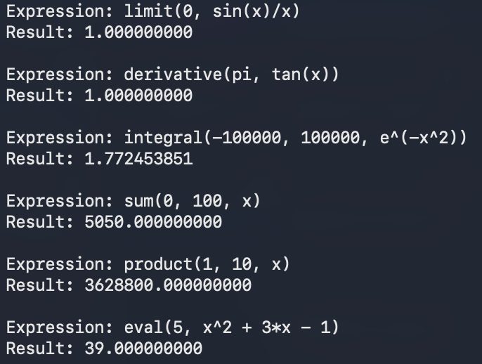

# Documentation

## Important Reminders
> [!NOTE]
> - Only use single letter variable names.
> - Only single-variable function are supported. If your function has multiple variables, they will all be treated as the **same variable**.
> - Do not use `e` as a variable name (`e` is reserved for Euler's number).
> - Use `arcsin(x)` instead of `sin^(-1)(x)` and `(sin(x))^(-1)`, `arccsc(x)` instead of `csc^(-1)(x)` and `(csc(x))^(-1)`, etc. for the inverse trig functions.
> - Put parantheses around all function calls and subscripts (for logarithm bases). For example: `log_(32)(sin(x))`.
> - `log` defaults to base-10 without a subscript (base) and `ln` is always base-e (do not include a subscript for `ln`).
> - Implicit multiplication is not yet supported. Thus, ensure to explicitly add multiplication signs (e.g., `42 * sin(5 / x)`).

> [!WARNING]
> Real numbers are represented using a `double`. Hence, results become increasingly more inaccurate for extremely large and small numbers.

## API Documentation
The following functions are provided:
- limit([point], [function])
- derivative([point], [function])
- integral([lower bound], [upper bound], [function])
- sum([lower bound], [upper bound], [function])
- product([lower bound], [upper bound], [function])
- eval([point], [function])

Below are the functions in conventional mathematical notation:

Let $c \in \mathbb{R}$ be [point] in all these expressions, $a \in \mathbb{R}$ be [lower bound], $b \in \mathbb{R}$ be [upper bound], and $f : \mathbb{R} \to \mathbb{R}$ be a function of $x$ for [function]. The functions listed above are equivalent to the following mathematical expressions:
$$
\begin{align}
    \lim_{x \to c} f(x) \\
    \left.\frac{d}{dx} f(x) \right|_{x=c} \\
    \int_a^b f(x)\ dx \\
    \sum_{i = a}^b f(x_i) \\
    \prod_{i = a}^b f(x_i) \\
    f(c)
\end{align}
$$

Below are some examples:
